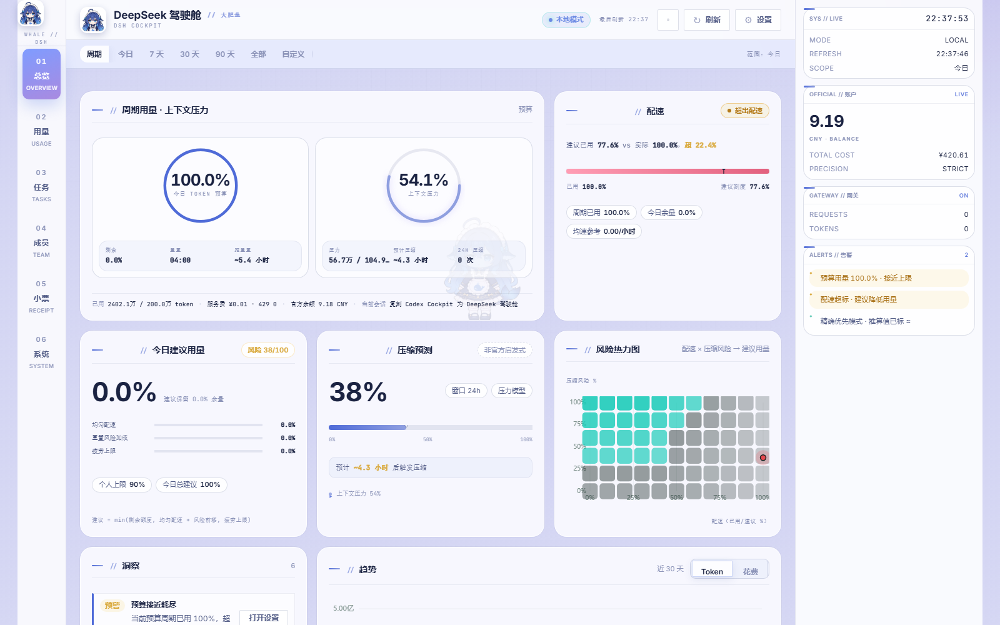
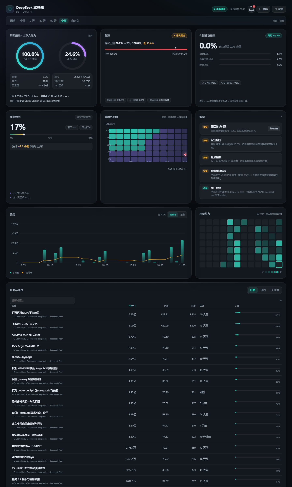

# DSH Cockpit · DeepSeek Harness 驾驶舱

<p>
  
  
  
  
  
</p>

**本地只读的 DeepSeek Harness 用量/成本/上下文驾驶舱**：Token 用量、官方余额与账单、任务级归因、压缩预测、团队共享计划、小票导出，以及一只住在右下角的 **DeepSeek 大肥鱼（鲸鱼娘）女仆桌宠**。

- **桌面双形态**：主窗口最小化 → 女仆桌宠挂件；双击挂件展开驾驶舱；
- **数据真值优先**：官方余额 / 官方累计花费 / DSH 真实 usage；推算值以 ≈ 标注；
- **隐私**：只读本地 DSH 会话，零遥测，不上传对话；
- **零运行时依赖**：核心仅 Node 内置模块；桌面壳为 C# + WebView2。

## 截图

| 驾驶舱主界面 | 女仆桌宠挂件 |
|---|---|
|  |  |

## 快速开始

```powershell
git clone https://github.com/Liyou2778/dsh-cockpit.git
cd dsh-cockpit
npm test                      # 109 tests
node src/cli.mjs doctor       # 环境自检
node src/cli.mjs serve --port 7777 --open
```

- Windows 桌面程序：见 [docs/DESKTOP.md](docs/DESKTOP.md)（C# + WebView2，含本地签名脚本）
- DSH 插件：见 [dsh-plugin/README.md](dsh-plugin/README.md)
- 团队同步 Worker：见 [docs/SYNC.md](docs/SYNC.md)
- 官方余额/账户数据：见 [docs/API-V2.md](docs/API-V2.md)

## 开源许可（重要）

| 范围 | 许可 |
|---|---|
| `src/`、`web/*.js/css/html`、`desktop/`、`test/`、`scripts/` 等**代码** | **MIT**（见 [LICENSE](LICENSE)） |
| `web/assets/pet/*.webm` 动画 | **CC BY-NC-SA 4.0**（署名 · **非商业** · 相同方式共享），来自 [PC2005-cloud/dsh-pet](https://github.com/PC2005-cloud/dsh-pet)，角色原型「溟月」 |
| `web/assets/pet/portrait.png`、`app-icon-src.png` 角色图 | 来自 [YunYueSama/codex-deepseek-pet](https://github.com/YunYueSama/codex-deepseek-pet)，按其声明使用（需署名作者与仓库；其自有素材允许商用） |

> 因含 CC BY-NC-SA 动画，**本项目整体按非商业使用**。若需商用，请替换 `web/assets/pet/*.webm` 为可商用素材或联系原作者授权。
> 完整来源与署名见 [NOTICE.md](NOTICE.md) 与 [web/assets/pet/NOTICE.md](web/assets/pet/NOTICE.md)。

## 致谢

- [Codex Cockpit](https://github.com/HouSiyuan2001/codex-cockpit)：产品形态与团队/额度模型参考
- [PC2005-cloud/dsh-pet](https://github.com/PC2005-cloud/dsh-pet)：女仆动画素材（CC BY-NC-SA 4.0）
- [YunYueSama/codex-deepseek-pet](https://github.com/YunYueSama/codex-deepseek-pet)：大肥鱼角色设定与立绘授权
- [MeteorNOX/DeepSeek-Balance-Whale-Widget](https://github.com/MeteorNOX/DeepSeek-Balance-Whale-Widget)：早期小鲸鱼挂件灵感（本项目未再分发其素材）

---

> DeepSeek Harness 的本地只读用量驾驶舱：**今天用了多少 token、花了多少钱、花在哪些任务、上下文还剩多少、什么时候会被压缩。**
> 只读、离线、零遥测、零运行时依赖；可作为 DSH 插件挂在 `/dsh-cockpit`。



> 上图为真实本机会话数据渲染（1440×2200，headless Chrome）：范围条、双环、配速、今日建议、压缩预测、**风险热力图**、**洞察**、趋势、热力日历、**任务/项目/子代理表**、舒适度、**小票构建器**。

## 它是什么 / 不是什么

**是**：架在 `~/.dsh/sessions` 上的观测器 + 分析器。读取 usage 数字与元数据 → 成本/配速/计划/压缩风险/任务归因/洞察 → 本地 Web 仪表盘 + CLI + DSH 插件 + 可选团队同步。

**不是**：不是 DeepSeek 官方产品；不代理模型请求；不读取对话正文；不做遥测；金额是估算不是账单。

## 能力总览（v2，对齐 Codex Cockpit 技术面）

| 域 | 能力 |
|---|---|
| 额度 | 三口径（预算/余额/上下文）、周期（日/周/月，04:00 换日）、个人上限 + 今日总建议双控件 |
| 配速 | 线性推荐 + 容差、`on_track/over_pace/unknown`、超速量化 |
| 计划 | uniform + 风险² 前移 + 疲劳上限（knee 可被个人舒适度覆盖） |
| 预测 | 压缩概率 + ETA + 因素解释 + **配速×风险二维热力图** |
| 分析 | **任务级归因**（搜索/排序/分页）、**项目维度**、**子代理树**、模型/工具 Top5、**规则化洞察** |
| 时间 | 范围条（周期/今日/7天/30天/90天/全部/自定义）、84 天热力、**日历下钻**（当日 Top 任务/模型/体感） |
| 成本 | 三档计价（缓存命中/未命中/输出）、**高峰/空闲双价（官方 ×0.5）**、**Search/Fetch 服务费（成功调用 × ¥0.005，下限估计）**、未知模型不猜价、价格表可覆盖 |
| 可靠性 | **重试/429/传输/服务端错误统计**（来自 `llm/retry`）、工具失败率、限流洞察与通知 |
| 官方对账 | **实时余额（显式开启）**、24h `Δ官方余额` vs 本地估算、偏差率、充值检测、快照历史 |
| 缺失估算 | 可选字符启发式（中文 0.6 / 其他 0.3 token/字符），**默认关闭、不计入成本** |
| 舒适度 | 5 档记录、固定 k 拟合（14 天半衰期）、**分箱模型**、历史日历 |
| 提醒 | 预算/上限/压缩/配速告警、铃铛未读、浏览器通知（可关） |
| 小票 | 任务勾选 + 范围 + 标题 → 2× PNG → 下载/剪贴板 |
| 集成 | CLI 20 命令、HTTP API v2、DSH Cordis 插件、**可选团队同步（设备即成员 + 共享计划）**（默认关闭） |
| 工程 | 零依赖、80 测试、E2E 5 路径、覆盖率门禁、lint、CI 矩阵、Skills |

## 快速开始

```bash
node src/cli.mjs status                 # 终端看一眼
node src/cli.mjs serve --open           # 仪表盘（默认 127.0.0.1:7777）
node src/cli.mjs config --set budget.tokens=40000000   # 按实际用量设预算
```

要求：**Node.js ≥ 22.15**（`node:zlib` zstd）。

## 本机代理网关（多 provider 精确计数，可选）

Codex Cockpit 能汇总多家工具，是因为它读取各工具自己的日志；DSH 只有 DeepSeek 数据。若要让**其它工具**也进入统计，用本机网关：把工具的 base_url 指到 `http://127.0.0.1:7891/v1`，网关转发请求并**精确记录上游返回的 usage**（不估算）。

```powershell
# 1) 开启网关（默认关闭）
node src/cli.mjs config --set gateway.enabled=true

# 2) 启动（前台；另开终端保持运行）
node src/cli.mjs gateway serve

# 3) 把工具 base_url 指到 http://127.0.0.1:7891/v1
#    多上游：/u/<name>/v1（先在 config 里配 gateway.upstreams）

# 4) 查看精确用量
node src/cli.mjs gateway status
node src/cli.mjs gateway stats --range 7d
```

- **精确**：tokens 来自上游官方 usage；缺失（如流式未返回 usage）记"未知"，不估算；
- **推算**：费用按价格表计算（≈）；
- **安全**：只监听 127.0.0.1；不记录 Authorization、请求/响应正文、工具参数；
- 限制：无法改 base_url 的订阅制工具（如部分 IDE 内置服务）抓不到；这类只能等官方导出或手动导入。

## 官方余额（实时，可选）

驾驶舱可以**按需实时**读取官方账户余额（`GET /user/balance`），用于「官方扣费 vs 本地估算」对账。

```bash
# 1) 设置 Key（仅当前终端，不落盘；不读 DSH 凭据）
$env:DEEPSEEK_API_KEY="sk-..."        # PowerShell
export DEEPSEEK_API_KEY="sk-..."      # bash

# 2) 显式开启（默认关闭）
node src/cli.mjs config --set balance.enabled=true

# 3) 立即取一次最新余额
node src/cli.mjs balance --refresh

# 可选：对账窗口（默认 24h；1h–7d；不足时自动回退"自首个快照起"）
node src/cli.mjs config --set balance.reconcileWindowMs=3600000
```

- **实时语义**：打开仪表盘 → 取一次；点「刷新」→ 强制绕过缓存；自动轮询用 15s TTL 防抖与并发合并。
- **对账**：按 24h 窗口（可配置 `balance.reconcileWindowMs`，1h–7d）对比 `Δ官方余额` 与本地估算（模型成本 + Search/Fetch 服务费），给出偏差率；窗口内无更早快照时**回退为"自首个快照起"（要求 ≥1h）**，便于开启后尽快看到对账；检测到充值/赠金变化时标记不可对账。
- **失败降级**：无 Key / 401 / 402 / 超时只影响余额卡，不影响其它数据；**Key 不落盘、不写日志**。
- **快照**：只存金额与时间，`~/.dsh-cockpit/balance.json`（0600 尽力）。

## 安装为 DSH 插件

```bash
node src/cli.mjs install-plugin --profile web --apply
# 重启 DSH → http://127.0.0.1:<gui端口>/dsh-cockpit
```

## CLI（节选，全部支持 `--json`）

| 命令 | 说明 |
|---|---|
| `scan` / `status` / `plan` | 扫描 / 状态 / 配速计划预测 |
| `tasks --range 7d --q 关键词 --sort tokens --page 1` | 任务排行 |
| `projects` / `subagents` / `insights` / `calendar --month` | 项目 / 子代理 / 洞察 / 月历 |
| `report --md` / `receipt` | 报告 / 小票数据 |
| `notify` / `watch --interval 60` | 告警 / 监听 |
| `backup --out f.json` / `restore f.json --dry-run` | 备份 / 恢复 |
| `sync status\|push\|pull\|enroll` | 团队同步（默认关闭） |
| `serve --port --open` / `doctor` / `config --set` / `install-plugin` | 服务 / 自检 / 配置 / 插件 |

## HTTP API（v2，节选）

`/api/status`（含 range/riskMap/insights/notifications/comfort.binned）、`/api/history`、`/api/tasks`、`/api/projects`、`/api/subagents`、`/api/insights`、`/api/calendar`、`/api/riskmap`、`/api/comfort`、`/api/notifications(/read)`、`/api/receipt`(GET/POST)、`/api/backup`、`/api/restore`、`/api/config`(GET/POST)、`/api/sync/status|push|pull|enroll`、`/api/rescan`、`/api/health`。完整契约见 [docs/API-V2.md](docs/API-V2.md)。

## 团队同步（可选，默认关闭）

自托管 Cloudflare Worker + D1：令牌只存 SHA-256、邀请 24h 单次、≤32 设备、`payload_hash` 去重 + `_ts` 单调守卫、限流缺失 fail-closed。

⚠️ **非端到端加密**：空间成员与 Cloudflare 管理员可读聚合数据；只同步「日期/模型/总量」聚合，**不含会话 id、标题、路径、对话**。部署与边界见 [docs/SYNC.md](docs/SYNC.md)。

**计划选择**：`wrangler.example.toml` = Workers Paid（$5/月，含限流绑定）；`wrangler.free-plan.toml` = Workers Free（限流降级、≤3 台设备建议，其余校验不变）。

**设备即成员 + 共享计划**（不依赖 DSH 账号体系）：

部署 Worker 后，本机一键创建空间（令牌只显示一次）：

```powershell
$env:DSH_COCKPIT_BOOTSTRAP_SECRET = "<Worker 的 bootstrap secret>"
node src/cli.mjs sync init --endpoint https://your-worker.workers.dev --name dev-a --space-name team
# 输出：space / device / 邀请码 / 访问令牌（owner）
$env:DSH_COCKPIT_SYNC_TOKEN = "ccs_..."   # 令牌只走环境变量，不落盘
node src/cli.mjs sync push
node src/cli.mjs sync invite               # 给第二台设备
```

第二台设备：

```powershell
node src/cli.mjs config --set sync.endpoint=https://your-worker.workers.dev
node src/cli.mjs config --set sync.enabled=true
node src/cli.mjs sync enroll --invite CCI-...   # 打印设备令牌 → 放入环境变量
```

日常：

```bash
node src/cli.mjs sync members                              # 成员列表（本机实时 + 远端快照）
node src/cli.mjs sync plan --daily-token-cap 20000000 --day-total-percent 90
node src/cli.mjs sync rename <deviceId> --name 我的笔记本
node src/cli.mjs sync remove <deviceId>                    # 仅 owner；撤销设备令牌
```

| 能力 | 说明 |
|---|---|
| 成员视图 | Web 任务区「成员」Tab：成员名/角色/今日 tokens·成本/计划占比/最后同步 |
| 共享计划 | 空间级 `dailyTokenCap` + `dayTotalPercent`（建议性，不做请求层限流） |
| 权限 | 读=任意成员；改名=owner 或本人；改计划/撤销=仅 owner |
| 降级 | 同步未开启 → 空态提示；离线 → 保留上次数据并标记 |

## 算法（移植 Codex Cockpit，版本可审计）

| 能力 | 版本 | 公式要点 |
|---|---|---|
| 成本 | `PRICING_V2` | 官方价（flash 2/0.04/8、v4-pro 9/0.3/27 ¥/M，高峰）；空闲 ×0.5；未知模型 → `null` |
| 配速 | `PACE_V1` | `起始已用 + 起始剩余 × 已过时间/总时长`；容差 0.5%/2min |
| 计划 | `PLAN_V1` | `min(剩余, 均匀 + (剩余−均匀)×p², knee×(1+1.5p)×周末0.75)` |
| 预测 | `FORECAST_V1` | 压力 sigmoid + 历史校准(±12) + 周内先验 → clamp[2,95] |
| 舒适 | `COMFORT_FIT_V1` | 固定 k 效率曲线加权拟合（14 天半衰期） |

详见 [docs/MODEL.md](docs/MODEL.md)；与参考产品的逐项对照/复刻度见 [docs/PARITY.md](docs/PARITY.md)。

## 隐私

- 只读 `~/.dsh/sessions/**/session.v{3,4}.jsonl[.zstd]`；**绝不写入** DSH 目录；正文/工具参数不读取。
- 写入仅 `~/.dsh-cockpit/`；零遥测；唯一可选网络是余额查询（env Key）与团队同步（显式开启）。
- 标题可打码（`ui.maskTitles`）；备份/恢复只含配置+舒适度+通知已读。
- 详见 [docs/PRIVACY.md](docs/PRIVACY.md)。

## 已知限制

- **金额是估算**：内置官方价（2026-11-03 核对）含高峰/空闲双价；**Search/Fetch 按成功工具调用计费**（一次搜索可能触发多次 provider 请求，结果是下限）；法定节假日需在 `pricingPolicy.holidays` 配置。
- 压缩预测是启发式，非官方。
- **可靠性仅覆盖可观测子集**：`RATE_LIMIT`/`TRANSPORT`/`SERVER` 重试；完整请求错误码与并发数不在会话事件中。
- 桌面悬浮窗/托盘/签名安装包**不提供**（DSH 形态下不适用，见 PARITY §8）。
- 团队同步为 P2 能力：默认关闭、非 E2E 加密、运维者负责保留期/删除。
- Web「今日」按浏览器本地日（后端周期 04:00 换日，凌晨 0–4 点边界可能差一天）。

## 开发与验证

```bash
npm test                # 80 tests（79 pass + 1 真实数据 SKIP）
npm run lint            # 0 错误（60 条冻结文件行宽告警）
npm run coverage        # src/core 行覆盖 89.90% ≥ 70%
npm run test:e2e        # Playwright 5 路径（需已安装 chromium）
npm run audit:public    # 发布前防泄漏审计
npm run doctor
```

## 官方生态（DeepSeek AI GitHub）

| 资源 | 链接 | 与本产品的关系 |
|---|---|---|
| DeepSeek Harness（DSH） | [deepseek-ai/deepseek-harness](https://github.com/deepseek-ai/deepseek-harness) | 本产品作为其 Cordis 插件运行（`/dsh-cockpit`） |
| DSH 文档 | [deepseek-harness.github.io](https://deepseek-harness.github.io/deepseek-harness/) | 插件/架构/安全说明的权威来源 |
| 官方推理框架 | [deepseek-ai/DeepInfer](https://github.com/deepseek-ai/DeepInfer) | V4.1-Flash 生产推理栈（DSpark/SWA/batch-invariant） |
| 官方 tokenizer/配方 | [deepseek-ai/deepseek-recipe](https://github.com/deepseek-ai/deepseek-recipe) | P3 精确估算的升级路径 |
| 生态接入列表 | [awesome-deepseek-integration](https://github.com/deepseek-ai/awesome-deepseek-integration) · [awesome-deepseek-agent](https://github.com/deepseek-ai/awesome-deepseek-agent) | 用户发现新工具的入口 |
| 官方价格/用量文档 | [api-docs.deepseek.com](https://api-docs.deepseek.com/zh-cn/quick_start/pricing) | 本产品价格表与口径的核对来源 |

## 许可证

MIT。产品模型与部分算法移植自 [Codex Cockpit](https://github.com/HouSiyuan2001/codex-cockpit)（MIT），致谢。


## 形象与素材署名

- 大肥鱼（DeepSeek 鲸鱼娘）女仆形象：角色图来自 [YunYueSama/codex-deepseek-pet](https://github.com/YunYueSama/codex-deepseek-pet)，按其声明使用（需署名作者与仓库）；
- 动画素材来自 [PC2005-cloud/dsh-pet](https://github.com/PC2005-cloud/dsh-pet)，角色原型「溟月」按 **CC BY-NC-SA 4.0** 使用（署名 · 非商业 · 相同方式共享）；
- 详见 `web/assets/pet/NOTICE.md`。
